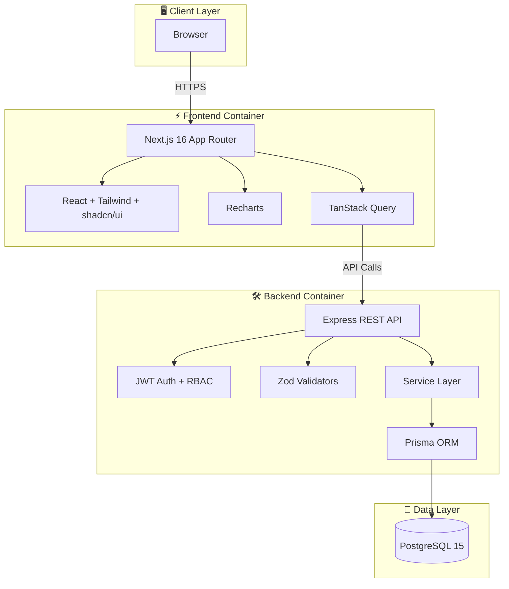
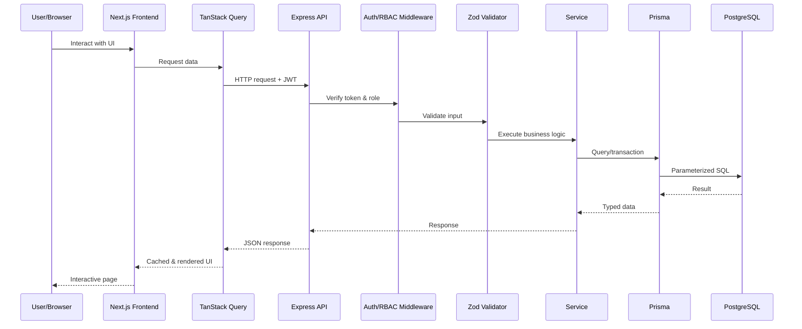

<div align="center">

# 🚀 NexLevr — Client & Campaign Management Platform

**A production-ready, role-based SaaS platform for marketing agencies to manage clients, campaigns, leads, tasks, and analytics.**

<p>
  <a href="https://nextjs.org/">
    
  </a>
  <a href="https://react.dev/">
    
  </a>
  <a href="https://www.typescriptlang.org/">
    
  </a>
  <a href="https://tailwindcss.com/">
    
  </a>
  <a href="https://ui.shadcn.com/">
    
  </a>
  <a href="https://nodejs.org/">
    
  </a>
  <a href="https://expressjs.com/">
    
  </a>
  <a href="https://www.prisma.io/">
    
  </a>
  <a href="https://www.postgresql.org/">
    
  </a>
  <a href="https://jwt.io/">
    
  </a>
  <a href="https://vercel.com/">
    
  </a>
  <a href="https://www.docker.com/">
    
  </a>
  
</p>

</div>

---

## 📋 Table of Contents

- [✨ Features](#-features)
- [🛠 Tech Stack](#-tech-stack)
- [🏗 Architecture](#-architecture)
- [🚀 Quick Start](#-quick-start)
- [🔧 Environment Variables](#-environment-variables)
- [📁 Project Structure](#-project-structure)
- [🌐 Deployment](#-deployment)
- [🤝 Contributing](#-contributing)
- [📄 License](#-license)

---

## ✨ Features

<div align="center">

| 🏷️ | Feature | Description |
|:---:|:---|:---|
| 🔐 | **JWT Authentication** | Secure login with bcrypt-hashed passwords and signed access tokens. |
| 🛡️ | **Role-Based Access Control** | Admin, Manager, and Team Member roles enforced on both frontend routes and backend endpoints. |
| 📊 | **Analytics Dashboard** | Real-time KPI cards, conversion metrics, and interactive charts powered by Recharts. |
| 🏢 | **Client Management** | Full CRUD for clients with status tracking, search, and campaign history. |
| 📢 | **Campaign Management** | Plan, launch, pause, and complete multi-channel marketing campaigns. |
| 🎯 | **Lead Pipeline** | Kanban-style CRM pipeline with status transitions, source tracking, and value estimation. |
| ✅ | **Task Management** | List and Kanban views for tasks with priorities, due dates, and assignees. |
| 🔔 | **Activity & Notifications** | In-app activity timeline and unread/read notification system. |
| 🌙 | **Modern UI/UX** | Responsive, accessible interface built with Tailwind CSS and shadcn/ui. |

</div>

### 👥 User Roles

| Role | Capabilities |
|------|--------------|
| **Admin** | Manage users, clients, campaigns, analytics, and system settings. |
| **Manager** | Manage assigned clients, create campaigns, assign tasks, and view analytics. |
| **Team Member** | View assigned clients and tasks, update task status, and view relevant campaigns. |

---

## 🛠 Tech Stack

### Frontend

| Technology | Purpose |
|------------|---------|
| [Next.js 16](https://nextjs.org/) | App Router, React framework, and static generation. |
| [React 19](https://react.dev/) | Declarative UI library. |
| [TypeScript](https://www.typescriptlang.org/) | Strict, static type safety. |
| [Tailwind CSS 4](https://tailwindcss.com/) | Utility-first styling. |
| [shadcn/ui](https://ui.shadcn.com/) | Accessible, composable UI components. |
| [Lucide React](https://lucide.dev/) | Consistent, lightweight iconography. |
| [Recharts](https://recharts.org/) | Interactive data visualization. |
| [Axios](https://axios-http.com/) | HTTP client with interceptors. |
| [TanStack Query](https://tanstack.com/query) | Server-state caching and synchronization. |

### Backend

| Technology | Purpose |
|------------|---------|
| [Node.js 20](https://nodejs.org/) | JavaScript runtime. |
| [Express.js](https://expressjs.com/) | Minimalist REST API framework. |
| [TypeScript](https://www.typescriptlang.org/) | End-to-end type safety. |
| [Prisma ORM](https://www.prisma.io/) | Type-safe database access and migrations. |
| [PostgreSQL 15](https://www.postgresql.org/) | Reliable, relational database. |
| [JWT](https://jwt.io/) | Stateless authentication tokens. |
| [bcryptjs](https://www.npmjs.com/package/bcryptjs) | Secure password hashing. |
| [Zod](https://zod.dev/) | Runtime schema validation. |
| [Helmet](https://helmetjs.github.io/) & [express-rate-limit](https://www.npmjs.com/package/express-rate-limit) | Security headers and rate limiting. |

### DevOps & Tooling

| Technology | Purpose |
|------------|---------|
| [Docker](https://www.docker.com/) & [Docker Compose](https://docs.docker.com/compose/) | Local and production containerization. |
| [npm workspaces](https://docs.npmjs.com/cli/v10/using-npm/workspaces) | Monorepo dependency management. |
| [Git](https://git-scm.com/) / GitHub | Version control and collaboration. |
| [Vercel](https://vercel.com/) | Frontend deployment and hosting. |

---

## 🏗 Architecture

NexLevr follows a clean **three-tier architecture**: a React/Next.js frontend, an Express REST API, and a PostgreSQL database accessed through Prisma.

### High-Level System Architecture



### Request Flow



### Design Principles

- **Separation of concerns**: Controllers handle HTTP, services handle business logic, and Prisma handles persistence.
- **Defense in depth**: Authentication and authorization run on both the frontend (protected routes) and backend (middleware).
- **Type safety**: Shared TypeScript types and Zod schemas reduce runtime errors.
- **Analytics from data**: Dashboard metrics are calculated from real database records, not hardcoded values.

---

## 🚀 Quick Start

### ✅ Prerequisites

- **Node.js** >= 20
- **npm** >= 10
- **Docker & Docker Compose** (optional, for PostgreSQL)
- **Git**

### 1️⃣ Clone the Repository

```bash
git clone https://github.com/your-username/nexlevr-platform.git
cd nexlevr-platform
```

### 2️⃣ Install Dependencies

```bash
npm install
```

This installs root workspace dependencies plus all dependencies for `frontend` and `backend` via npm workspaces.

### 3️⃣ Configure Environment Variables

```bash
cp .env.example .env
```

Edit `.env` and set strong values for `JWT_SECRET` and `POSTGRES_PASSWORD`.

### 4️⃣ Start the Database

#### Option A: PostgreSQL via Docker Compose (Recommended)

```bash
npm run db:up
```

#### Option B: Existing PostgreSQL Instance

Update `DATABASE_URL` in `.env` to point to your existing database.

### 5️⃣ Run Migrations & Seed Data

```bash
npm run db:migrate
npm run db:seed
```

The seed creates:

- 3 users with different roles
- 5 clients
- 8 campaigns
- 20 leads
- 15 tasks
- Activities and notifications

<details>
<summary>🔓 Default Login Credentials</summary>

| Email | Password | Role |
|-------|----------|------|
| `admin@nexlevr.com` | `NexLevr@2025` | Admin |
| `manager@nexlevr.com` | `NexLevr@2025` | Manager |
| `team@nexlevr.com` | `NexLevr@2025` | Team Member |

</details>

### 6️⃣ Run the Development Servers

```bash
npm run dev
```

- 🌐 Frontend: [http://localhost:3000](http://localhost:3000)
- 🔌 Backend API: [http://localhost:5000](http://localhost:5000)
- 🩺 Health check: `GET http://localhost:5000/`

You can also run them separately:

```bash
npm run dev:frontend
npm run dev:backend
```

### 7️⃣ Build for Production

```bash
npm run build
```

---

## 🔧 Environment Variables

| Variable | Description | Example |
|----------|-------------|---------|
| `POSTGRES_USER` | PostgreSQL username | `nexlevr` |
| `POSTGRES_PASSWORD` | PostgreSQL password | `nexlevr_dev_password` |
| `POSTGRES_DB` | PostgreSQL database name | `nexlevr` |
| `POSTGRES_PORT` | PostgreSQL host port | `5432` |
| `DATABASE_URL` | Prisma connection string | `postgresql://nexlevr@localhost:5432/nexlevr?schema=public` |
| `JWT_SECRET` | Secret key for JWT signing | `change-this-in-production` |
| `JWT_EXPIRES_IN` | JWT expiration time | `7d` |
| `PORT` | Backend server port | `5000` |
| `NODE_ENV` | Runtime environment | `development` |
| `FRONTEND_URL` | Frontend origin for CORS | `http://localhost:3000` |
| `NEXT_PUBLIC_API_URL` | Public API base URL for frontend | `http://localhost:5000/api` |
| `CORS_ORIGIN` | Allowed CORS origin | `http://localhost:3000` |

> **Security note:** Never commit `.env` or any secret to Git. The `.gitignore` file already excludes environment files.

---

## 📁 Project Structure

```
.
├── backend/
│   ├── src/
│   │   ├── config/          # Environment and app configuration
│   │   ├── controllers/     # HTTP request handlers
│   │   ├── middleware/      # Auth, RBAC, error handling, security
│   │   ├── routes/          # API route definitions
│   │   ├── services/        # Business logic and database operations
│   │   ├── types/           # TypeScript type declarations
│   │   ├── utils/           # JWT, password hashing, helpers
│   │   ├── validators/      # Zod schemas for input validation
│   │   ├── app.ts           # Express application setup
│   │   └── server.ts        # Server entry point
│   ├── Dockerfile           # Multi-stage backend image
│   └── package.json
├── frontend/
│   ├── src/
│   │   ├── app/             # Next.js App Router pages
│   │   ├── components/      # Reusable UI components
│   │   ├── context/         # React context providers
│   │   ├── hooks/           # Custom data-fetching hooks
│   │   ├── lib/             # Utilities & API client
│   │   ├── providers/       # Third-party provider wrappers
│   │   └── types/           # Frontend TypeScript types
│   ├── public/              # Static assets
│   ├── Dockerfile           # Multi-stage frontend image
│   └── next.config.ts
├── prisma/
│   ├── schema.prisma        # Single source of truth data model
│   └── seed.ts              # Development seed data
├── docker-compose.yml       # Full-stack local/production orchestration
├── .env.example             # Environment variable template
├── .gitignore               # Ignore rules for the monorepo
├── package.json             # Workspace root and shared scripts
└── README.md                # You are here
```

---

## 🌐 Deployment

### ▲ Deploy Frontend to Vercel

1. Push your code to GitHub.
2. Import the repository on [Vercel](https://vercel.com/).
3. Set the **Root Directory** to `frontend`.
4. Add the environment variable:
   - `NEXT_PUBLIC_API_URL` → your production API URL.
5. Deploy!

### 🐳 Deploy Full Stack with Docker Compose

Build and start all services (PostgreSQL, backend, frontend):

```bash
docker-compose up --build -d
```

Access the application:

- Frontend: [http://localhost:3000](http://localhost:3000)
- Backend API: [http://localhost:5000](http://localhost:5000)
- API docs base: `http://localhost:5000/api`

Stop all services:

```bash
docker-compose down
```

To remove volumes (**WARNING:** deletes database data):

```bash
docker-compose down -v
```

<details>
<summary>✅ Production Checklist</summary>

- [ ] Generate a strong, unique `JWT_SECRET`
- [ ] Use strong PostgreSQL credentials
- [ ] Set `NODE_ENV=production`
- [ ] Configure `FRONTEND_URL` and `CORS_ORIGIN` to your production domain
- [ ] Update `NEXT_PUBLIC_API_URL` to your production API URL
- [ ] Run migrations before starting the backend
- [ ] Use HTTPS in production
- [ ] Do not commit `.env` to version control
- [ ] Set up automated backups for PostgreSQL

</details>

---

## 🤝 Contributing

Contributions are welcome! Please follow these steps:

1. Fork the repository.
2. Create a feature branch: `git checkout -b feature/your-feature-name`
3. Make your changes and ensure the project still builds and typechecks:
   ```bash
   npm run typecheck
   npm run build
   ```
4. Commit your changes with a clear message.
5. Open a pull request describing what you changed and why.

Please keep code consistent with the existing style, write meaningful commit messages, and ensure permissions are enforced on both frontend and backend when adding new features.

---

## 📄 License

This project is licensed under the [MIT License](LICENSE).

Built for educational and portfolio purposes as part of the **NexLevr Full Stack Developer internship**.

---

<div align="center">

**Built with ❤️ using Next.js, Express, Prisma & PostgreSQL.**

</div>
